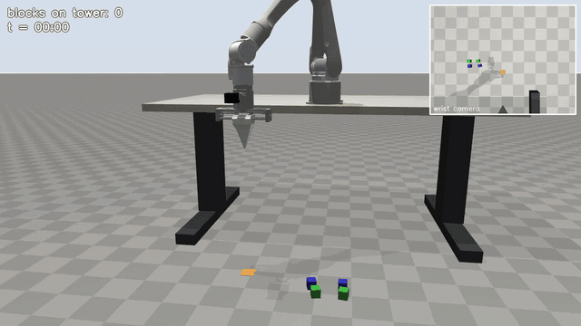

# airbot_play_blocks_building

AIRBOT Play 机械臂真机自动搭积木实验：视觉识别物块颜色与位置，闭环控制机械臂抓取、对齐、叠放。

宿主机上的 ROS Noetic、MoveIt 和全部依赖由 [pixi](https://pixi.sh) 安装（基于 [RoboStack](https://robostack.github.io)），**宿主机不需要 Docker，也不需要 apt 安装 ROS**。机械臂主服务 `airbot_server` 仍在机械臂容器中运行，宿主机通过 gRPC 连接它。

[](docs/media/sim_demo.mp4)

MuJoCo 仿真中自动搭到 13 层（16 倍速，左上角是实际用时；点击图片可看 8 倍速的视频）。右上角是腕部相机画面，视觉识别用的就是它。仿真和真机运行的是同一套程序，见[仿真](#仿真)。

## 运行结构

```
机械臂容器（Docker）                       宿主机（pixi 环境，本仓库）
┌──────────────────────────────┐  gRPC   ┌──────────────────────────────────────────────┐
│ airbot_server -i can0 -p 50051│◄───────►│ pixi run bringup   gRPC 桥接 + MoveIt + RViz  │
└──────────────────────────────┘ :50051  │ pixi run keyboard  键盘遥控                   │
                                         │ pixi run vision    视觉识别（USB 相机）       │
                                         │ pixi run pick-place  搭积木控制               │
                                         └──────────────────────────────────────────────┘
```

## 安装

要求：Linux x86_64（已在 Ubuntu 24.04 上验证），`git`，约 5 GB 磁盘空间。

```bash
# 1. 安装 pixi（只需一次）
curl -fsSL https://pixi.sh/install.sh | bash      # 装完后重新打开终端

# 2. 获取代码（--recursive 会一并拉取子模块）
git clone --recursive https://github.com/OpenGHz/airbot_play_blocks_building.git
cd airbot_play_blocks_building

# 3. 安装环境并编译 ROS 工作空间
pixi run build

# 4. 自检
pixi run doctor
```

首次 `pixi run build` 会下载约 500 个包（数分钟，取决于网络），之后再运行只做增量编译。所有内容都装在仓库内的 `.pixi/` 和 `ros_ws/` 中，不修改 `~/.bashrc`，也不需要 `sudo`。删除仓库目录即完全卸载。

已经 clone 但没有拉取子模块时：

```bash
git submodule update --init --recursive
```

### 国内网络

可以给 conda-forge 和 PyPI 配置镜像（写入仓库内的 `.pixi/config.toml`，只影响本项目）：

```bash
pixi config set --local mirrors '{"https://conda.anaconda.org/conda-forge": ["https://mirrors.tuna.tsinghua.edu.cn/anaconda/cloud/conda-forge"]}'
pixi config set --local pypi-config.index-url https://pypi.tuna.tsinghua.edu.cn/simple
```

ROS 软件包所在的 `robostack-noetic` 频道清华镜像没有收录，仍从官方源下载；下载慢时可以使用代理。

## 使用

每个终端都先 `cd` 到本仓库目录，然后直接执行 `pixi run <任务>`，不需要 `source` 任何文件。也可以先执行 `pixi shell` 进入环境，之后像以前一样直接输入 `roslaunch`、`rosparam`、`python3 ...` 等命令。

```bash
# 终端 0（机械臂容器）：启动机械臂主服务
xhost + && airbot_server -i can0 -p 50051

# 终端 1：连接机械臂并启动 MoveIt / RViz（保持运行）
pixi run bringup

# 终端 2：键盘遥控，确定初始位姿（修改 configs/control/real.yaml）
pixi run keyboard

# 终端 3：视觉参数（修改 configs/vision/real.yaml）；最后的数字是相机设备号
pixi run hsv-finder -na -d 2
pixi run vision -t pi0 -vd 2          # Pick 阶段期望位置；Place 阶段用 -t pl0

# 控制调参：终端 2 + 终端 3 + 终端 4
pixi run pick-place adjust 0          # 终端 2；Place 阶段用 adjust 1
pixi run vision -vd 2                 # 终端 3
pixi run rosparam set control_param1 20.25   # 终端 4；Place 阶段为 control_param2

# 完整运行
pixi run pick-place go 20.25 40.51    # 终端 2；末尾加 open-place 为开环放置（见下）
pixi run vision -vd 2                 # 终端 3
```

**开环放置**（`pixi run pick-place go P1 P2 open-place`）：抓取仍然靠视觉跟踪；放置不用视觉，每一块都直接到第一块的正上方，下降 `GAP_PLACE` 后松开。物块在夹爪里的偏差不会被纠正，会带到塔上。

**不对称的放置停下条件**（`pixi run pick-place go P1 P2 place-stop 0.5`，可选）：默认的闭环放置在 |dx|、|dy| < 2 px 时就停，从第 2 块起夹爪总从塔的同一侧逼近，停在 2 px 死区的这一侧边缘，每层偏约 1 mm 并逐层累加。加 `place-stop ε` 后，沿逼近方向（两指之间的空隙方向）剩余偏差小于 ε 像素才停，越过 2 px 以内或横向 2 px 以内照旧停。ε 越小每层偏得越少，调节的步数越多；ε 不能为 0（识别以 0.5 px 为单位）。

**用规划场景**（`pixi run pick-place go P1 P2 scene`，可选）：默认和原来的程序一样，抓取区和塔之间按固定路点移动（先升高、再水平移、松开后上升并朝抓取区一侧侧移 7.5 cm），不做碰撞检查，安全靠这些按真机布局定的余量，段之间会停一下。加 `scene` 后在 MoveIt 规划场景里放入地面和塔，抓取区和塔之间的移动绕开它们规划、一条轨迹走完，安全依赖模型（手指、塔的碰撞体）和实际的接近程度。不加 `scene` 时程序启动会去掉上次加 `scene` 运行时留在 MoveIt 里的地面和塔。详见 [docs/pick_place_flow.md](docs/pick_place_flow.md) §2、§4。

**看手里的物块**（`pixi run vision -vd 2 --held-cube`，可选）：默认的闭环放置让夹爪对准塔顶物块，物块在夹爪里的偏差原样带到塔上（各种放置修正的作用见[放置闭环修正](docs/place_closed_loop_analysis.md)）。加 `--held-cube` 后，Place 阶段同时识别手里的物块（另一种颜色，图像最下面），按它沿两指空隙方向偏离夹爪中心多少移动对准目标，让手里的物块对准塔顶物块；手指开合方向不修正。需要视觉配置里的 `EXPECT_HELD_REF`、`HELD_SCALE`：仿真里由 `pixi run sim-calib-vision --apply` 算出，真机上还没有标定（方法见 `configs/vision/real.yaml` 里的注释）。看不到手里的物块时不发偏差，机械臂停在原地。

`pixi run <任务>` 后面的参数会原样传给对应的命令。《实验手册》原命令与新命令的逐条对照见 [docs/commands.md](docs/commands.md)。

### 动作失败或抓取区空了

- **动作失败**（最常见的是搭到机械臂够不到的高度，放好最后一块后竖直上升够不到）：机械臂停在原地，终端打印哪个动作失败、当前位置和已搭的块数。按回车：先竖直离开塔顶，再绕开塔回 Home，打印"共搭了 N 块"后退出；输入 `r`：重试失败的动作。
- **抓取区没有可抓的物块**（设置了跟踪范围 `PICK_AREA_HALF_SIZE` 时）：机械臂回到扫描位姿，补充物块后按回车继续，输入 `q` 回 Home 并退出。
- 塔和地面在 MoveIt 规划场景里（RViz 里可以看到），抓取区和塔之间的移动自动绕开塔，塔每放一层更新一次。

### 任务列表

| 任务 | 实际执行的命令 | 说明 |
|------|----------------|------|
| `build` | `catkin build`（先执行 `configure`） | 安装环境并编译 `ros_ws/` |
| `clean` | `catkin clean -y` | 清理编译结果 |
| `doctor` | `scripts/doctor.sh` | 检查子模块、编译、Python 模块、图形界面、机械臂服务（或仿真进程）、相机 |
| `bringup` | `scripts/bringup.sh` → `roslaunch launch/bringup.launch driver:=… env_type:=… url:=$ARM_URL port:=$ARM_PORT` | 先找机械臂：机械臂服务能连上时为真机（`env_type:=real`），`pixi run sim` 在运行时为仿真（`driver:=sim env_type:=sim`），两个都没有、或者同时在运行时会直接提示。`env_type` 决定后面各任务读 `configs/*/real.yaml` 还是 `sim.yaml` |
| `keyboard` | `scripts/keyboard.sh` → `rosrun easy_arm_control airbot_play_keyboard.py --init_pose configs/control/<env_type>.yaml` | 键盘遥控 |
| `hsv-finder` | `scripts/hsv_finder.sh` → `python demo/hsv_finder.py` | 滑动条确定 HSV 阈值 |
| `vision` | `scripts/vision.sh` → `python Best_Contour.py -cfg ./configs/vision/<env_type>.yaml` | 物块识别，窗口内容见下面的"视觉窗口" |
| `pick-place` | `bash run_pick_place.sh` | 搭积木控制（`adjust 0/1`、`go <p1> <p2>`，加 `open-place` 为开环放置，加 `place-stop ε` 为不对称的放置停下条件，加 `scene` 为用规划场景绕开地面和塔规划移动） |
| `record` | `python data_driven/record_data.py` | 录制演示数据 |

`pixi task list` 可以随时查看。

### 视觉窗口（Output）

`pixi run vision` 的 Output 窗口在相机画面上画出每一帧的识别过程，真机和仿真相同。加 `--record` 同时存成视频（默认 `runs/vision/vision_<时间>.mp4`，也可以 `--record 路径`）。

| 画面上的元素 | 含义 |
|------|------|
| 左上第 1 行 | 当前阶段：`PICK stage: cube to grasp`（抓取，对准要抓的物块）或 `PLACE stage: tower top`（放置，对准塔顶物块），以及识别的颜色（1 或 2）；暂停时为 `PAUSED` |
| 左上第 2 行 | 选中目标时为发给控制程序的偏差（像素 x、y，角度）；没有目标时为 `no target` |
| 灰色轮廓 | 当前颜色的轮廓，但面积（`AREA_LIMIT_*`）或长宽比不合格，不参与选择；旁边的数字是轮廓面积（像素²） |
| 黄色轮廓 | 通过筛选的候选 |
| 红色粗框 `target` | 选中的目标：候选里离品红十字最近的一个 |
| 品红十字 | 参考点（`EXPECT_X`, `EXPECT_PICK_REF`）。Pick 阶段要把目标中心对到这里；两个阶段的 x 偏差都相对它计算 |
| 品红横线 `edge ref`（Place） | 塔顶物块图像上边沿的期望位置 `EXPECT_PLACE_REF`（图像上边沿：图像里最上面的那条边，实际是物块的下边沿） |
| 青色横线（Place） | 塔顶物块图像上边沿的当前位置；y 偏差 = 品红横线 − 青色横线 |
| 橙色框 `held`（Place，`--held-cube` 或 `-t pl0/pl1`） | 手里的物块；左上第 3 行为它的中心 x、图像上边沿，以及品红横线（图像上边沿的对准目标）因此移动了多少 |
| 调暗的区域（Place） | 不参与识别：第 423 行以下（真机和本仓库的仿真都会裁），以及 `PLACE_CROP_X` 以外的列 |

### 机械臂服务地址

默认连接 `localhost:50051`（机械臂容器使用 host 网络时即是如此）。其他地址可以用环境变量指定：

```bash
ARM_URL=192.168.1.10 ARM_PORT=50051 pixi run bringup
```

## 地面搭塔

桌面上通常放着其他设备，积木塔和抓取区可以都放在桌外的地面上：机械臂装在桌沿、正对桌外，塔和抓取区在它前方的地面上。这样能用上机械臂从最低到最高的整个可达范围，比放在桌面上能多搭很多层。仿真的默认场景就是这种布局（`configs/scene/sim_floor.yaml`，见[仿真](#仿真)），可以先在仿真里跑一遍。

**摆放**

- 抓取区放在扫描位姿的前方：扫描位姿下腕部相机只看得到夹爪前方的地面。
- 抓取区的物块离塔至少约 13 cm（夹爪张开时半宽约 7.5 cm），物块之间留出夹爪张开的空间。
- 机械臂底座后方（回零点要经过）不要放东西。

**记录位置**：和桌面上一样，按手册 §7 用 `pixi run keyboard` 把夹爪移到位、按 `=` 读数，填进 `configs/control/real.yaml`。读到的都是基座坐标系里地面上方的值，**不需要量桌高**。

- `PICK_POSITION_*`、`PICK_GRASP_Z`：抓取区的扫描位姿和下抓高度。高度都是指尖的高度（末端点 `custom_end_link` 在两指的指尖），`PICK_GRASP_Z` 就是下抓时指尖离桌面的距离。
- `PLACE_POSITION_Z`：第一块的松开高度。地面往往不平，塔下面和抓取区可能差几毫米，这时在放置点把夹爪降到地面上的物块处单独记下；之后每一层都在它上面加 `CUBE_HEIGHT`。

**可选项**（`real.yaml` 里以注释列出，默认不启用）：

| 键 | 作用 |
|----|------|
| `PLACE_SETTLE_TIME` | 到塔上方后停稳的时间（s）：第 1 块松开前、之后开始视觉调节前都等这么久。不设时和原来一样，第 1 块 1 s，之后 3 s |
| `TRANSIT_Z_MIN` | 只在用规划场景（`scene`）时：抓起后横移时末端的最低高度。地面搭塔建议设为 `PICK_GRASP_Z + CUBE_HEIGHT + 0.01`，手里的物块先越过抓取区的其他物块 |
| `PICK_AREA_HALF_SIZE`、`PLACE_TRACK_HALF_SIZE` | 跟踪范围：视觉跟踪时末端只能在抓取区 / 塔周围的矩形内，防止锁定抓取区外或塔上的同色物块。半边长取"物块分布范围的一半 + 约 3 cm"；抓取区不以扫描点为中心时再设 `PICK_AREA_CENTER` |
| `PLACE_RETREAT_Y` | 只在用规划场景（`scene`）时：放好、竖直上升后沿 y 侧移的距离，方向自动朝抓取区一侧。不设时不侧移，只靠规划场景绕开塔（不用规划场景时固定侧移 7.5 cm） |

## 仿真

用 MuJoCo 仿真代替机械臂容器，其他终端的命令和真机相同。`bringup` 会自动发现仿真中的机械臂，各程序改用 `configs/*/sim.yaml`；抓取区的物块被抓完后会自动重新摆放。

机械臂和夹爪的模型（网格、小臂长度、底板）取自 DISCOVERSE 最新的 airbot_play 模型，MoveIt 和仿真用同一份 URDF（来源见 `ros_ws/src/airbot_play_models/*/SOURCE.md`）；腕部相机的安装位置沿用原来的仿真。机械臂立在 275 × 161 mm 的底板上，底板转了 90°（长边左右、短边前后，底座中心离底板前沿 80.6 mm），整块放在桌面上，前沿和桌沿齐平。机械臂的碰撞体（和外观网格重合）不画出来，在 MuJoCo 窗口左侧的 Group enable 里勾上 Geom 3 可以看到。末端点 `custom_end_link` 在两指的指尖，配置里的高度都是指尖的高度。真机（新款，小臂 290 mm）也用这份模型：`configs/control/real.yaml` 里是期望位姿，换模型后不用改。和以前（旧模型，末端点在指尖上方 5.6 mm）相比，真机指尖实际到达的位置：抓取处前移约 17 mm，塔处偏约 (+14, +11) mm；扫描、下抓和低层放置的高度相差不到 1.5 mm，所以 `configs/vision/real.yaml` 的参考值仍然可用；在 MoveIt 里竖直上升能到的高度变低，塔的上限从 7 块变成 6 块。

```bash
pixi run sim                     # 终端 0：仿真（代替 airbot_server），打开 MuJoCo 窗口
pixi run bringup                 # 终端 1
pixi run vision -vd 2            # 终端 3：仿真中 -vd 2 对应虚拟腕部相机
pixi run pick-place go 90 100    # 终端 2：完整运行
```

**在 MuJoCo 窗口里动手**，和真机上随时可以做的一样（窗口左下角有提示）：

| 操作 | 方法 |
|------|------|
| 拿起、放下物块 | 双击选中物块，按住 Ctrl 加右键拖动（加 Shift 时沿地面 / 桌面移动），Ctrl 加左键拖动转动它。松手后物块端正地放在它下面的东西上（地面、桌面或另一块物块），所以也可以手工往塔上放 |
| 移动机械臂在桌上的安装位置 | 双击选中机械臂底座，Ctrl 加右键拖动，整台机械臂在桌面上平移（底板不能离开桌面；会撞到桌子时不动）。和真机一样只有机械臂动，桌子、地面上的标记和物块不动，所以 `configs/control/sim.yaml` 里记录的位置要按手册 §7 重新记录。`pixi run sim-ctl arm save` 把当前位置写进场景文件（`MOUNT_OFFSET`），下次启动沿用 |

| 任务 | 说明 |
|------|------|
| `sim-record` | 录制整个场景（含腕部相机小窗），保存到 `runs/sim/record_*.mp4`，Ctrl+C 结束；上面的演示视频就是这样录的 |
| `sim-ctl cube ...` | 操作仿真中的物块：`list`、`reset`、`respawn`、`take`、`to-gripper`、`put-under`、`nudge` |
| `sim-ctl arm ...` | 机械臂的安装位置：`where`、`mount --dx 0.05`（或 `--x`/`--y`，相对场景文件里的位置，m）、`save` |
| `sim-vision-check` | 在渲染图上跑视觉识别，检查抓取区的物块不会连成一片、各阶段锁定的都是正确的物块。改了场景、光照或 `configs/vision/sim.yaml` 后运行 |
| `sim --scene tabletop` | 和 `real.yaml` 一致的布局（抓取区和塔都在机械臂所在的桌面上），用来复现真机的高度上限 |

### 测试

| 任务 | 说明 |
|------|------|
| `test` | 单元测试和机械臂驱动的契约测试（仿真驱动连不开窗口的仿真，`airbot_py` 驱动连假的 `airbot_server`），不需要 ROS。GitHub Actions 上也跑这一项 |
| `test-e2e <场景>` | 在仿真里跑完整流程（独立的 ROS master，不影响正在运行的程序），日志和结果在 `runs/e2e/`。场景：`floor`（地面搭 6 块）、`open-place`（同上，开环放置）、`held-cube`（同上，视觉加 `--held-cube`；`floor`、`held-cube` 可再加 `--place-stop 0.5`；`floor`、`open-place`、`held-cube`、`limit`、`golden` 可再加 `--scene`，用规划场景）、`limit`（真机布局搭到上限，按回车回 Home）、`baseline`（改动前的程序，应在第 6 块后卡住；真机用旧模型时是第 7 块）、`kill-sim`（中途关掉仿真）、`golden`（改动前后发给 MoveIt 的运动目标对比） |
| `lint` | 检查 Python 代码的格式和常见问题（ruff，规则在 `ruff.toml`，不含 `ros_ws/src` 下的子模块），GitHub Actions 上也跑 |
| `fmt` | 按 ruff 格式化代码并应用安全的自动修复；提交前跑一次，`lint` 就能通过 |

## 目录结构

```
├── pixi.toml / pixi.lock        # 环境与任务定义（lock 文件锁定所有依赖的精确版本）
├── airbot_play_pick_place.py    # 搭积木主控制程序（由 run_pick_place.sh 启动）
├── airbot_play_transfer.py      # 抓取区与塔之间的转移：地面和塔加进 MoveIt 规划场景
├── airbot_play_rules.py         # 各层高度、跟踪范围等不依赖 ROS 的规则（单元测试覆盖）
├── Best_Contour.py              # 物块视觉识别
├── run_pick_place.sh
├── configs/{control,vision}/{real,sim}.yaml   # 控制 / 视觉参数（真机 / 仿真）
├── configs/scene/               # 仿真场景（桌子、塔和抓取区的位置），只有仿真用
├── launch/bringup.launch        # 启动桥接节点 + MoveIt（真机和仿真共用）
├── sim/                         # MuJoCo 仿真（pixi run sim、sim-* 任务）
├── tests/                       # pixi run test；tests/e2e/ 是 pixi run test-e2e
├── data_driven/                 # 演示数据录制与转换
├── demo -> ros_ws/src/easy_arm_control/demo
├── scripts/                     # pixi 激活、工作空间配置、自检、各任务的启动脚本
├── vendor/                      # 不在 PyPI 上的依赖（airbot_py gRPC 客户端）
├── docs/commands.md             # 《实验手册》命令对照
└── ros_ws/src/
    ├── airbot_play_models/          # 机械臂模型（URDF + 网格），从 airbot_play_models 拷贝
    ├── airbot_play_moveit_configs/  # MoveIt 配置，从 airbots_ros1_gazebo 拷贝
    ├── easy_arm_control/            # 子模块：MoveIt 上层控制库（原 airbot_play_control_upper）
    ├── airbot_play_moveit1_base/    # 子模块：moveit1_interface（MoveIt 启动、轨迹跟随、gRPC 桥接）
    └── trac_ik/                     # 子模块：TRAC-IK 1.6.6（RoboStack 未提供，源码编译）
```

拷贝进来的包内各有一个 `SOURCE.md`，记录来源仓库和提交。

## 常见问题

**`pixi run bringup` 提示"无法连接机械臂主服务"**：先在机械臂容器中启动 `airbot_server`，或用 `ARM_URL` / `ARM_PORT` 指定正确的地址。（直接用 `roslaunch` 启动而服务未就绪时，桥接节点会一直等待且不响应 Ctrl+C，这就是 `bringup` 先做检查的原因。）

**相机打不开 / 画面不是机械臂相机**：`pixi run doctor` 会列出所有 `/dev/video*` 及其名称，按实际设备号修改 `-d` / `-vd` 参数。笔记本自带相机通常占用 0 和 1。

**终端出现 `AttributeError: 'NoneType' object has no attribute 'close'`**（`hsv-finder`）：可以忽略。

**子模块目录为空，或 `pixi run build` 报找不到路径**：执行 `git submodule update --init --recursive`。

**更新代码后编译异常**：

```bash
git pull && git submodule update --init --recursive
pixi run clean && pixi run build
```

**日志里的 `SyntaxWarning: invalid escape sequence`、`Failed to import pyassimp`、`IK plugin ... relies on deprecated API` 等警告**：来自上游依赖，不影响使用。

## 许可证

[MIT](LICENSE)。`vendor/` 和各子模块按各自的许可证分发。
