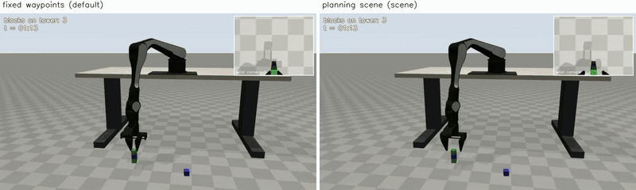
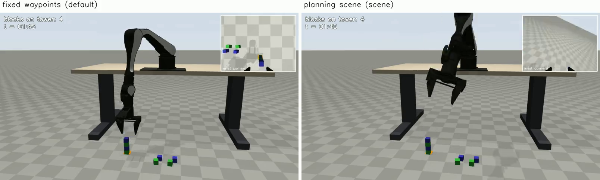
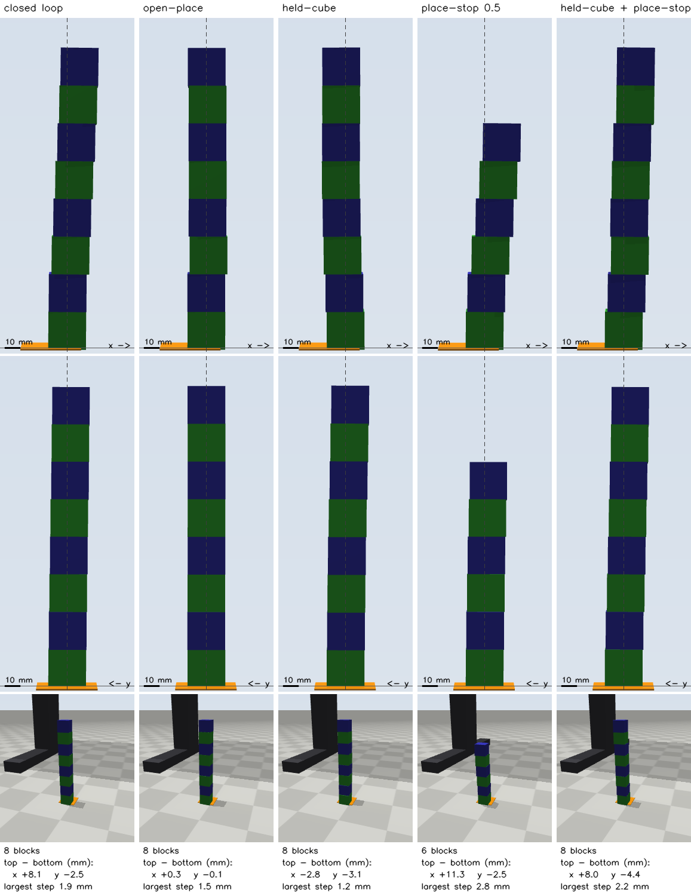
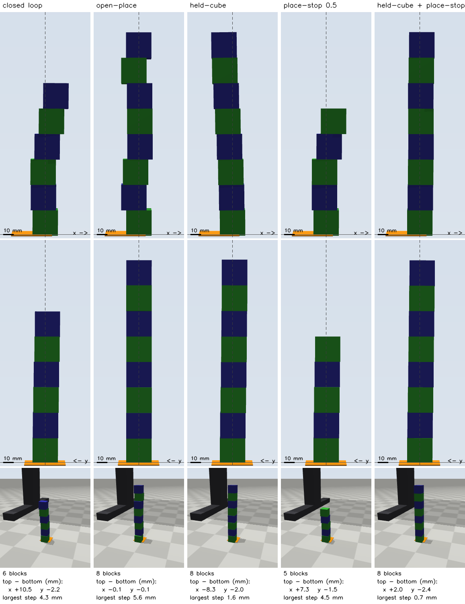
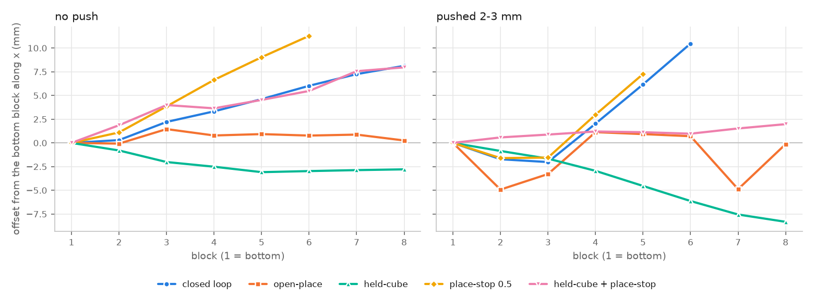

# 放置方式对比（仿真）

在 MuJoCo 仿真里对比两件事：

1. 抓取区和塔之间的转移方式：固定路点（默认）和规划场景（`scene`）。看过程动作，附录像。
2. 五种放置方式（闭环修正策略）：看最终搭成的塔。

各种修正的原理和误差模型见 [放置闭环修正](place_closed_loop_analysis.md)。

## 条件

- 代码：`feat/mujoco-sim@f9f652e`，加上 e2e 的 `--nudge`、`--video` 两个选项（和本文同一批改动）；2026-11-27。
- 场景：地面场景（`configs/scene/sim_floor.yaml`，桌高 0.475 m），控制 `configs/control/sim.yaml`，视觉 `configs/vision/sim.yaml`。e2e 设 `control_param1` = 90、`control_param2` = 100，抓取区布局的随机种子为 1，每次运行相同。
- 每次目标 8 块。坐标都是机械臂基座坐标系：x 向前，也是放置时两指之间的空隙方向；从第 2 块起，夹爪从塔的 −x 一侧逼近（[pick_place_flow.md](pick_place_flow.md) §2）。
- **人为抓偏**（e2e `--nudge`）：每块抓起、离开抓取高度 15 mm 后，把手里的物块沿两指空隙方向推 2 ~ 3 mm，方向随机。推的序列每次运行都一样（种子 0），依次为 +2.64、−2.04、−2.02、+2.91、+2.61、+2.54、−2.94、+2.00 mm。
- **每种方式只跑了一次。** 同一种方式在两种条件下差约 1 mm/层的情况也有（§2.3），所以小于这个量的差别不能作为结论。

## 1. 转移方式：固定路点 vs 规划场景

<div align="center">

[](media/place_comparison/transfers.mp4)

</div>

动图是第 3 块回程到第 4 块回程的一段（4 倍速，10 s），点击打开完整录像 [transfers.mp4](media/place_comparison/transfers.mp4)：左边固定路点，右边规划场景，同一布局各搭 8 块，4 倍速，55 s。两次都是闭环放置（默认）。

| | 固定路点（默认） | 规划场景（`scene`） |
|---|---|---|
| 搭成 | 8 块，塔没被碰 | 8 块，塔没被碰 |
| 第 8 块相对底块 | x +8.1，y −2.5 mm | x +7.6，y −2.7 mm |
| 每块用时 | 27.6 s | 28.2 s |
| 去程（抓取区 → 塔） | 4.5 ~ 6.1 s | 5.0 ~ 6.9 s |
| 回程（塔 → 抓取区） | 4.4 ~ 4.5 s | 3.9 ~ 6.8 s |
| 回程末端最高（离地） | 50 ~ 200 mm，随塔高增加 | 第 1 ~ 3 块 50 ~ 101 mm；第 4 块 481 mm；第 5 ~ 7 块 223 ~ 273 mm |
| 回程末端最远（向前） | 251 ~ 262 mm | 第 1 ~ 3 块 250 ~ 261 mm；第 4 块 668 mm；第 5 ~ 7 块 346 ~ 511 mm |
| 转移时离塔最近 | 17.9 mm | 15.9 mm |
| 转移中途停顿（≥ 0.2 s） | 0 次 | 0 次 |

- **塔搭得一样。** 转移方式不影响放置，两次的塔差不到 1 mm。
- **固定路点每次走同一条路。** 先竖直升高、再水平移到塔上方；回程竖直上升、朝抓取区一侧侧移 7.5 cm 后回抓取区。路径随塔高整体抬高，形状不变。仿真里各段之间没有可见的停顿。
- **规划场景每次的回程都不一样。** OMPL（RRTConnect）每次随机求解，只要不碰地面和塔就行，不求路径短。前 3 块的回程和固定路点差不多，第 4 块绕到了离地 0.48 m、向前 0.67 m 的地方（下图右），之后几块也比固定路点高、远。用时因此在 3.9 ~ 6.8 s 之间变化。真机上这样的大弧线更容易碰到桌外的东西：规划场景里只有地面和塔。

<div align="center">



</div>

## 2. 放置方式：最终的塔

| 方式 | 怎么打开 | 修正了什么 |
|---|---|---|
| 闭环（默认） | `pixi run pick-place go P1 P2` | 夹爪对准塔顶物块：消掉机械臂定位误差 |
| 开环 | 加 `open-place` | 不修正，每块都去第 1 块的点 |
| `--held-cube` | 视觉加 `--held-cube` | 手里的物块对准塔顶物块：消掉沿两指空隙方向的抓取偏差 |
| `place-stop 0.5` | 加 `place-stop 0.5` | 不对称停下条件：消掉死区偏差（约 1 mm/层） |
| `--held-cube` + `place-stop 0.5` | 两个都加 | 两项都消掉 |

### 2.1 不加干扰

<div align="center">



</div>

每列一种方式：第 1 行沿基座 y 看（x 向右），第 2 行沿基座 x 看（y 向左），都是正投影，同一比例尺（左下角 10 mm），虚线过底块中心；第 3 行是透视图。图下是第 8 块（或最后一块）相对底块的偏移和相邻两层的最大错位。

### 2.2 人为抓偏 2 ~ 3 mm

<div align="center">



</div>

### 2.3 逐层偏移

<div align="center">



</div>

| 方式 | 不加干扰：块数 | 顶块相对底块 x, y（mm） | 最大错位 | 抓偏：块数 | 顶块相对底块 x, y（mm） | 最大错位 | 每块用时 |
|---|---|---|---|---|---|---|---|
| 闭环（默认） | 8 | +8.1, −2.5 | 1.9 | **6**（停下） | +10.5, −2.2 | 4.3 | 27.6 s |
| 开环 | 8 | +0.3, −0.1 | 1.5 | 8 | −0.1, −0.1 | 5.6 | 23.6 s |
| `--held-cube` | 8 | −2.8, −3.1 | 1.2 | 8 | −8.3, −2.0 | 1.6 | 26.8 s |
| `place-stop 0.5` | **6**（停下） | +11.3, −2.5 | 2.8 | **5**（停下） | +7.3, −1.5 | 4.5 | 28.1 s |
| `--held-cube` + `place-stop 0.5` | 8 | +8.0, −4.4 | 2.2 | 8 | +2.0, −2.4 | 0.7 | 28.6 s |

每块用时是不加干扰那次的；抓偏时各方式的用时和它相差 0.4 s 以内。

<details>
<summary>每块沿 x、y 相对底块的偏移（mm）</summary>

不加干扰：

| 块 | 闭环 | 开环 | `--held-cube` | `place-stop 0.5` | 两项一起 |
|---|---|---|---|---|---|
| 2 | +0.3, −0.3 | −0.1, +0.1 | −0.8, −0.3 | +1.1, −0.3 | +1.9, −0.5 |
| 3 | +2.2, −0.7 | +1.5, −0.0 | −2.0, −0.6 | +3.8, −0.8 | +4.0, −1.2 |
| 4 | +3.3, −1.1 | +0.8, −0.1 | −2.5, −1.0 | +6.6, −1.3 | +3.6, −1.9 |
| 5 | +4.6, −1.4 | +0.9, −0.1 | −3.1, −1.4 | +9.0, −1.9 | +4.5, −2.5 |
| 6 | +6.0, −1.9 | +0.8, −0.2 | −3.0, −2.0 | +11.3, −2.5 | +5.5, −3.1 |
| 7 | +7.3, −2.1 | +0.9, −0.1 | −2.9, −2.5 | — | +7.6, −3.8 |
| 8 | +8.1, −2.5 | +0.3, −0.1 | −2.8, −3.1 | — | +8.0, −4.4 |

人为抓偏：

| 块 | 闭环 | 开环 | `--held-cube` | `place-stop 0.5` | 两项一起 |
|---|---|---|---|---|---|
| 2 | −1.7, −0.3 | −4.9, −0.1 | −0.9, −0.3 | −1.6, −0.3 | +0.6, −0.3 |
| 3 | −2.0, −0.8 | −3.3, −0.1 | −1.7, −0.8 | −1.5, −0.7 | +0.9, −0.8 |
| 4 | +2.0, −1.3 | +1.1, −0.1 | −2.9, −1.2 | +3.0, −1.1 | +1.2, −1.1 |
| 5 | +6.2, −1.8 | +0.9, −0.1 | −4.5, −1.4 | +7.3, −1.5 | +1.1, −1.4 |
| 6 | +10.5, −2.2 | +0.7, −0.1 | −6.1, −1.7 | — | +1.0, −1.7 |
| 7 | — | −4.9, −0.1 | −7.6, −2.0 | — | +1.5, −2.0 |
| 8 | — | −0.1, −0.1 | −8.3, −2.0 | — | +2.0, −2.4 |

</details>

### 2.4 读法

- **抓偏传不传到上面的层。**
  - 闭环和 `place-stop` 不看手里的物块，抓偏原样留在这一层，并传给上面所有层：抓偏时这两种的塔跟着推的方向走（第 4 ~ 6 块都推了 +2.5 ~ +2.9 mm，这几层每层偏 +4 mm 左右）。
  - 开环每块都去同一个点，每层只带着自己那一块的抓偏，不累加：相邻层最大错位 5.6 mm，但顶块相对底块只偏 0.1 mm。
  - `--held-cube` 和两项一起用时，抓偏被消掉了：相邻层的错位不再跟着推的序列变，最大 1.6 mm 和 0.7 mm。
- **不加干扰时每层都偏的量（系统偏差，沿 x）。** 闭环 +1.2 mm/层，`place-stop` +2.3 mm/层，`--held-cube` −0.4 mm/层，两项一起 +1.1 mm/层，开环约 0（仿真里机械臂几乎没有定位误差，见[放置闭环修正](place_closed_loop_analysis.md) §2.4）。
  - `place-stop` 比闭环每层多偏 1.1 mm，和死区偏差的估计（沿 −x 约 1 mm/层，同上 §2.3）一致：去掉死区偏差后，原来被它抵消的那部分抓取偏差（沿 +x）露了出来。
  - 闭环在这里每层偏 +1.2 mm，比[放置闭环修正](place_closed_loop_analysis.md) §2.4 的旧数据（8 块偏约 2 mm）大。旧数据是换 DISCOVERSE 模型、把末端点移到指尖之前测的，抓取偏差变了，这次没有再拆分各项。
  - 看手里物块的两种方式，同一方式两次运行的差别就有约 1 mm/层：`--held-cube` 不加干扰 −0.4、抓偏 −1.2 mm/层；两项一起 +1.1、+0.3 mm/层。各只跑了一次，分不清是推的影响还是运行之间的波动。
- **停下的三次**（闭环抓偏、`place-stop` 两次）不是塔倒了：放置调节时夹爪跟着歪了的塔走到了跟踪范围的边上（`configs/control/sim.yaml` 的 `place_track_half_size: [0.02, 0.02]`），程序报"跟踪目标连续 10 帧超出塔周围的跟踪范围"，按回车后回 Home 退出。跟踪范围以 `place_position_x/y` 为中心，第 1 块放在它前方 1 cm，所以塔顶沿 +x 偏到约 10 mm 就出界。要搭得更高，就要把这个范围放宽。
- **用时。** 开环每块 23.6 s，其他 26.8 ~ 28.6 s，多出的 3 ~ 5 s 是放置时的视觉调节。

## 3. 小结

- 转移方式：两种搭出来的塔一样。固定路点每次路径相同、可预期；规划场景的回程偶尔绕大弧线（这次是 0.48 m 高、0.67 m 远），用时也不稳定。
- 放置方式：仿真里没有机械臂定位误差，所以闭环的长处体现不出来，开环最直。要对付抓偏，只有 `--held-cube`（及两项一起用）能消掉它，不让它传到上面的层；这两种方式自己每层还剩 −1.2 ~ +1.1 mm 的偏差，两次运行之间就差约 1 mm/层，要再多跑几次才能分出高下。
- 真机上机械臂有定位误差，`--held-cube` 还没有标定（[放置闭环修正](place_closed_loop_analysis.md) §6），这些结论要在真机上重新验证。

## 复现

每种方式一条命令，加 `--nudge` 为人为抓偏，结果在 `runs/e2e/<场景>_<时间>/`：

```bash
pixi run test-e2e floor --blocks 8 --video                    # 闭环，固定路点，录像
pixi run test-e2e floor --blocks 8 --scene --video            # 闭环，规划场景，录像
pixi run test-e2e open-place --blocks 8 [--nudge]
pixi run test-e2e held-cube --blocks 8 [--nudge]
pixi run test-e2e floor --blocks 8 --place-stop 0.5 [--nudge]
pixi run test-e2e held-cube --blocks 8 --place-stop 0.5 [--nudge]
```

图和录像由 `tests/e2e/compare_runs.py` 从运行目录生成（`towers`：最终的塔；`chart`：逐层偏移；`table`：偏移表；`video`：两次录像并排），用法见文件开头。§1 的动图从并排录像里截出：

```bash
ffmpeg -ss 18.3 -to 28.0 -i transfers.mp4 -vf "fps=10,scale=800:-2:flags=lanczos,split[a][b];[a]palettegen=max_colors=128:stats_mode=diff[p];[b][p]paletteuse=dither=bayer:bayer_scale=4:diff_mode=rectangle" transfers_block4.gif
```
